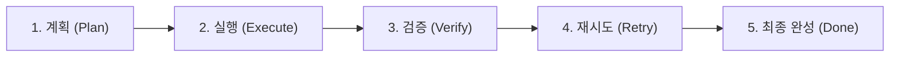

<div align="center">

# Make_Rule_md

**오픈소스 Markdown (*.md) 표준 벤치마킹 및 AI 에이전트 작업 규격서**  
*Benchmarking Industry-Leading Open-Source Standards for Flawless Markdown & Code Generation*

[](LICENSE)
[](#2-벤치마크-오픈소스-출처)
[](#1-최우선-구현절차-규칙-ecc-기반-5단계-라이프사이클)

</div>

<br/>

## 1. [최우선 구현절차 규칙] ECC 기반 5단계 라이프사이클

사용자의 요청에 따라 [`affaan-m/ecc`](https://github.com/affaan-m/ecc)의 개발 철학 및 Harness 운영 원칙을 **모든 작업의 최우선 절차 규칙**으로 설정합니다.

향후 사용자가 입력하는 모든 지시 프롬프트는 아래의 5단계를 엄격히 준수하여 순차적으로 수행됩니다:



1. **`[계획 (Plan)]`**: 기존 코드/문서 사전 검증(Research & Reuse), 최소 변경 범위 확정, 단계별 설계 및 리스크 도출.
2. **`[실행 (Execute)]`**: 단순성 우선(Simplicity First), 불필요한 추상화 금지, 엄격한 타입 준수(Zero `any`, Zero `as`).
3. **`[검증 (Verify)]`**: 실측 증거주의(Evidence Before Assertion). 빌드/테스트 명령어 실제 실행 및 종료 코드(Exit Code 0) 확인.
4. **`[재시도 (Retry)]`**: 검증 실패 시 근본 원인(Root Cause) 진단 후 자율 디버그 루프 수행 (성공할 때까지 반복).
5. **`[최종 완성 (Final Completion)]`**: 핵심 결과, 실측 증거, 파일 링크를 포함하여 **최대 3줄 이내**로 간결히 보고.

*상세 명세: [`STANDARDS/00_HIGHEST_PRIORITY_ECC_WORKFLOW.md`](STANDARDS/00_HIGHEST_PRIORITY_ECC_WORKFLOW.md) 및 [`ECC_IMPLEMENTATION_RULE.md`](ECC_IMPLEMENTATION_RULE.md)*

---

## 2. 벤치마크 오픈소스 출처 (Reference Matrix)

본 저장소에는 사용자의 요청에 따라 다음 6대 대표 오픈소스의 공식 코드베이스 및 핵심 명세가 로컬로 복제되어 있습니다:

| 프로젝트명 | 복제 대상 및 주요 파일 | 원본 저장소 | 벤치마킹 핵심 역할 |
| :--- | :--- | :--- | :--- |
| **`ecc`** ⭐ *(최우선)* | [`ecc`](ecc/) (AGENTS.md, rules/, workflows/) | [affaan-m/ecc](https://github.com/affaan-m/ecc) | **구현절차 최우선 규칙 (`계획 -> 실행 -> 검증 -> 재시도 -> 최종 완성`)**, TDD, 자율 루프 |
| **`awesome-design-md`** | [`awesome-design-md/design-md`](awesome-design-md/design-md) (160+개 브랜드 명세) | [VoltAgent/awesome-design-md](https://github.com/VoltAgent/awesome-design-md) | `DESIGN.md` YAML 토큰 규격 (색상, 타이포, 간격) 및 시각 가이드라인 |
| **`Figma-Context-MCP`** | [`Figma-Context-MCP/README.md`](Figma-Context-MCP/README.md), `CLAUDE.md` | [GLips/Figma-Context-MCP](https://github.com/GLips/Figma-Context-MCP) | MCP README 히어로 배너, 토큰 효율화, 고가치 주석 정책 및 테스팅 철학 |
| **`firecrawl-mcp-server`** | [`firecrawl-mcp-server/README.md`](firecrawl-mcp-server/README.md) | [firecrawl/firecrawl-mcp-server](https://github.com/firecrawl/firecrawl-mcp-server) | 프로덕션 MCP README 표준, 도구 선택 매트릭스, 멀티 클라이언트 설치 가이드 |
| **`chrome-devtools-mcp`** | [`chrome-devtools-mcp`](chrome-devtools-mcp) (AGENTS.md, docs, skills) | [ChromeDevTools/chrome-devtools-mcp](https://github.com/ChromeDevTools/chrome-devtools-mcp) | `AGENTS.md` Google 엔지니어링 표준, Zero `any`/`as`/`!` 엄격 타이핑 규칙 |
| **`magic-mcp`** | [`magic-mcp`](magic-mcp) (README.md, llms-install.md, skills) | [21st-dev/magic-mcp](https://github.com/21st-dev/magic-mcp) | 현대적 UI 컴포넌트 생성 에이전트 규격, `llms-install.md`, 스킬 구조 |

*상세 커밋 및 메타데이터는 [`SOURCES.json`](SOURCES.json)에서 확인하실 수 있습니다.*

---

## 3. 표준 명세서 디렉토리 (Synthesized Standards)

벤치마킹된 오픈소스의 규칙을 체계화한 가이드라인은 [`STANDARDS/`](STANDARDS/) 디렉토리에 수록되어 있습니다:

1. **[`00_HIGHEST_PRIORITY_ECC_WORKFLOW.md`](STANDARDS/00_HIGHEST_PRIORITY_ECC_WORKFLOW.md)**: **[최우선]** ECC 기반 5단계 구현 절차 규격서 (`계획 -> 실행 -> 검증 -> 재시도 -> 최종 완성`)
2. **[`RULE_MD_STANDARDS.md`](STANDARDS/RULE_MD_STANDARDS.md)**: 오픈소스 Markdown (*.md) 종합 표준 및 사전 점검 체크리스트
3. **[`DESIGN_MD_SPEC.md`](STANDARDS/DESIGN_MD_SPEC.md)**: `DESIGN.md` 표준 (Google Stitch & VoltAgent 디자인 토큰 규격)
4. **[`MCP_README_SPEC.md`](STANDARDS/MCP_README_SPEC.md)**: MCP 서버 및 오픈소스 라이브러리 `README.md` 작성 규격서
5. **[`AGENTS_MD_SPEC.md`](STANDARDS/AGENTS_MD_SPEC.md)**: `AGENTS.md` / `CLAUDE.md` 에이전트 실행 및 엄격 제약 규격서
6. **[`SKILL_MD_SPEC.md`](STANDARDS/SKILL_MD_SPEC.md)**: 에이전트 확장 도구용 `SKILL.md` 작성 규격서

---

## 4. 디렉토리 구조 (Repository Layout)

```text
Make_Rule_md/
├── ecc/                       # [최우선] Everything Claude Code (규칙, 에이전트 하네스)
├── awesome-design-md/         # VoltAgent 공식 레포 (160+개 브랜드 DESIGN.md 포함)
│   └── design-md/             # Apple, Stripe, Linear, Supabase 등 실측 디자인 시스템
├── Figma-Context-MCP/         # Framelink MCP 레포 (README.md, CLAUDE.md 등)
├── firecrawl-mcp-server/      # Firecrawl 공식 MCP 레포 (README.md 등)
├── chrome-devtools-mcp/       # Google Chrome DevTools 공식 MCP 레포 (AGENTS.md 등)
├── magic-mcp/                 # 21st.dev Magic MCP 레포 (skills, llms-install.md 등)
├── STANDARDS/                 # 벤치마크 기반 종합 표준 규격서
│   ├── 00_HIGHEST_PRIORITY_ECC_WORKFLOW.md # [최우선] 5단계 라이프사이클 명세
│   ├── RULE_MD_STANDARDS.md   # 마크다운 종합 작성 표준
│   ├── DESIGN_MD_SPEC.md      # DESIGN.md 작성 규격
│   ├── MCP_README_SPEC.md     # README.md 작성 규격
│   ├── AGENTS_MD_SPEC.md      # AGENTS.md 작성 규격
│   └── SKILL_MD_SPEC.md       # SKILL.md 작성 규격
├── ECC_IMPLEMENTATION_RULE.md # 최우선 구현 규칙 요약본
├── SOURCES.json               # 6개 원본 오픈소스 출처 및 커밋 메타데이터
└── README.md                  # 본 통합 레퍼런스 안내서
```
