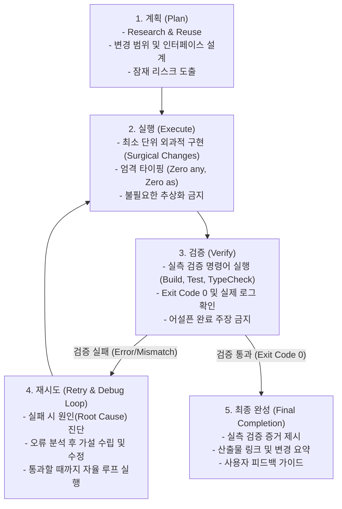

# [최우선 규칙] ECC 기반 5단계 구현 절차 규격서 (00_HIGHEST_PRIORITY_ECC_WORKFLOW)
> **최우선 준수 강제 (Highest Priority Binding Rule)**  
> **벤치마크 출처**: [`affaan-m/ecc`](https://github.com/affaan-m/ecc) (Enhanced Coding Harness / Everything Claude Code)  
> 본 규격서는 향후 사용자가 입력하는 모든 프롬프트 및 구현 작업에서 **가장 우선순위가 높은 최상위 규칙**으로 작동합니다. 모든 작업은 반드시 **`계획 -> 실행 -> 검증 -> 재시도 -> 최종 완성`**의 5단계 라이프사이클을 엄격히 준수해야 합니다.

---

## 1. 5단계 구현 라이프사이클 개요 (The 5-Stage Lifecycle)



---

## 2. 단계별 세부 실행 원칙 (Detailed Stage Protocols)

### 1단계: 계획 (Plan) — "Plan Before Execute"
1. **사전 조사 및 기존 자산 재사용 (Research & Reuse)**:
   - 새로운 코드를 즉흥적으로 작성하기 전, 프로젝트 내부 및 오픈소스 벤치마크(`Make_Rule_md`)의 기존 패턴과 인터페이스를 먼저 확인한다.
   - 외부 라이브러리 연동 시 공식 문서나 소스코드 정의를 직접 확인하여 잘못된 API 가정을 차단한다.
2. **외과적 범위 확정 (Surgical Scope Definition)**:
   - 사용자 요청에 직접 연결되는 파일과 함수만 수정 대상으로 한정한다.
   - 인접 코드 리팩토링이나 불필요한 포맷팅 변경 등 범위 이탈(Scope Creep)을 엄격히 금지한다.
3. **위험 요소 및 가설 도출**:
   - 변경 시 영향을 받을 수 있는 모듈과 잠재적 부작용을 사전에 파악한다.

### 2단계: 실행 (Execute) — "Surgical Changes & Strict Simplicity"
1. **단순성 우선 (Simplicity First)**:
   - 오직 문제 해결에 필요한 최소한의 코드만 작성한다.
   - 불필요한 조기 추상화, 단 1회용 헬퍼 함수, 발생할 수 없는 예외에 대한 과도한 방어 로직을 배제한다.
2. **엄격한 타입 안전성 (Strict Typing — No `as any`)**:
   - `any` 타입 및 안전하지 않은 타입 캐스팅(`as any`, `as unknown as Type`)을 절대 사용하지 않는다.
   - non-null 단언(`!`) 및 `@ts-ignore`로 타입 에러를 가리지 않고 인터페이스와 계약을 완벽히 맞춘다.
3. **가치 있는 주석 (High-Value Comments)**:
   - 코드가 하는 일을 단순 복사한 주석은 작성하지 않는다.
   - **존재 이유(Why)**, **비직관적 주의점(Warnings)**, **의도적 미처리(Negative Space)**만 간결히 남긴다.

### 3단계: 검증 (Verify) — "Evidence Before Assertion"
1. **실측 증거주의 (Evidence-Based Verification)**:
   - "완료되었습니다", "수정되었습니다", "통과했습니다"라는 주장을 하기 전, **반드시 실제 검증 명령어(테스트 러너, 빌드 도구, 타입 체커, 런타임 스크립트)를 직접 실행**한다.
   - 출력된 콘솔 로그 전문과 종료 코드(Exit Code)를 확인하여 실측 데이터를 확보한다.
2. **TDD 및 재현 검증 (Reproducing Test)**:
   - 버그 수정 시 실패를 재현하는 테스트를 먼저 실행하여 오류를 확인한 뒤 수정을 검증한다.

### 4단계: 재시도 (Retry & Self-Correction) — "Autonomous Debug Loop"
1. **근본 원인 진단 (Root Cause Diagnosis)**:
   - 빌드 실패나 테스트 오류 발생 시 에러 메시지 겉면만 임시 땜질하지 않고 근본 원인을 추적한다.
2. **체계적 가설 검증**:
   - [오류 식별] -> [원인 가설 수립] -> [정밀 수정] -> [재검증] 단계를 자율적으로 반복한다.
3. **루프 탈출 제약**:
   - 해결되지 않는 구조적 문제나 외부 권한/경계 이슈 발생 시에만 문제를 구체화하여 사용자에게 보고한다.

### 5단계: 최종 완성 (Final Completion) — "Clear & Structured Reporting"
1. **최대 3줄 엄격 제한 (Max 3 Lines Rule)**:
   - 최종 완성 보고 내용은 핵심 결과와 상태를 포함하여 **최대 3줄 이내**로 간결하게 끊어서 전달한다.
2. **실측 증거 및 산출물 압축 명시**:
   - 실행한 검증 결과와 변경된 핵심 파일 링크(`file://`)를 3줄 규격 안에 압축하여 제공한다.
3. **군더더기 텍스트 배제**:
   - 인사말이나 중복된 설명, 장황한 부연 설명을 일체 생략하고 핵심 팩트만 남긴다.

---

## 3. 에이전트 작업 시 프롬프트 대응 템플릿

사용자가 새로운 작업을 지시할 때, 에이전트는 내부적으로 다음 프레임워크를 동작시킵니다:

```text
[계획 (Plan)]
- 분석 내용, 참조 오픈소스/문서, 수정 계획 및 예상 리스크

[실행 (Execute)]
- 정밀 코드 작성 및 파일 수정

[검증 (Verify)]
- 실행한 검증 명령어 및 실제 출력 로그 확인

[재시도 (Retry)] (오류 발생 시에만 진행)
- 발생 오류 분석 -> 정밀 수정 -> 재검증 통과

[최종 완성 (Final Completion)]
- 최종 결과 요약, 실측 증거 및 산출물 파일 링크
```
