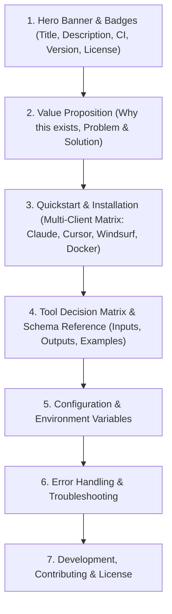

# MCP & 오픈소스 README.md 작성 규격서 (MCP_README_SPEC)
> **벤치마크 출처**: `firecrawl/firecrawl-mcp-server` & `GLips/Figma-Context-MCP`

---

## 1. README.md 구조 체계 (Standard Layout)

---

## 2. 세부 섹션 작성 원칙

### 2.1 Hero Banner & Badges
- 다크/라이트 모드 대응 `<picture>` 태그 적용.
- 프로젝트의 1줄 본질(What)과 핵심 혜택(Why)을 센터 정렬로 명시.
- 배지: 라이선스, npm 주간 다운로드, 디스코드/커뮤니티 링크 배치.

### 2.2 설치 및 클라이언트 연동 매트릭스 (Installation Matrix)
다양한 AI 에디터 및 환경에 즉시 복사-붙여넣기 가능한 JSON 설정 스니펫을 필히 포함:
- **Cursor / Windsurf (`mcpServers`)**
- **Claude Desktop (`claude_desktop_config.json`)**
- **npx 직접 실행 / Docker 컨테이너 실행**
- **원격 Streamable HTTP 모드**

### 2.3 도구 선택 매트릭스 (Tool Decision Matrix)
에이전트가 복수의 도구 중 어떤 것을 호출해야 할지 혼란을 방지하기 위해 상단에 요약 매트릭스를 제공합니다.

| Tool Name | Purpose | When to Use | Typical Latency |
| :--- | :--- | :--- | :--- |
| `service_scrape` | 단일 URL 콘텐츠 추출 | 특정 웹페이지 텍스트/마크다운 추출 시 | < 2s |
| `service_crawl` | 웹사이트 전체 순회 | 도메인 전체 서브페이지 탐색 시 | 비동기 (Job ID 반환) |
| `service_search` | 웹 검색 결과 수집 | 구체적인 질의어로 상위 문서 탐색 시 | < 1.5s |

### 2.4 도구 스키마 및 입출력 명세
각 도구마다:
1. **Description**: 도구가 수행하는 명확한 동작
2. **Parameters (JSON Schema)**: 필수(Required)와 선택(Optional) 속성, 기본값, 타입
3. **Response Schema**: 에이전트가 받게 될 구조화된 데이터 예시
4. **Example Call**: 실제 호출 예시 스니펫

### 2.5 에러 처리 및 트러블슈팅
- 대표적인 HTTP/API 에러 코드(`400 Bad Request`, `401 Unauthorized`, `429 Rate Limited`)별 원인과 대응 조치를 테이블로 제공.
